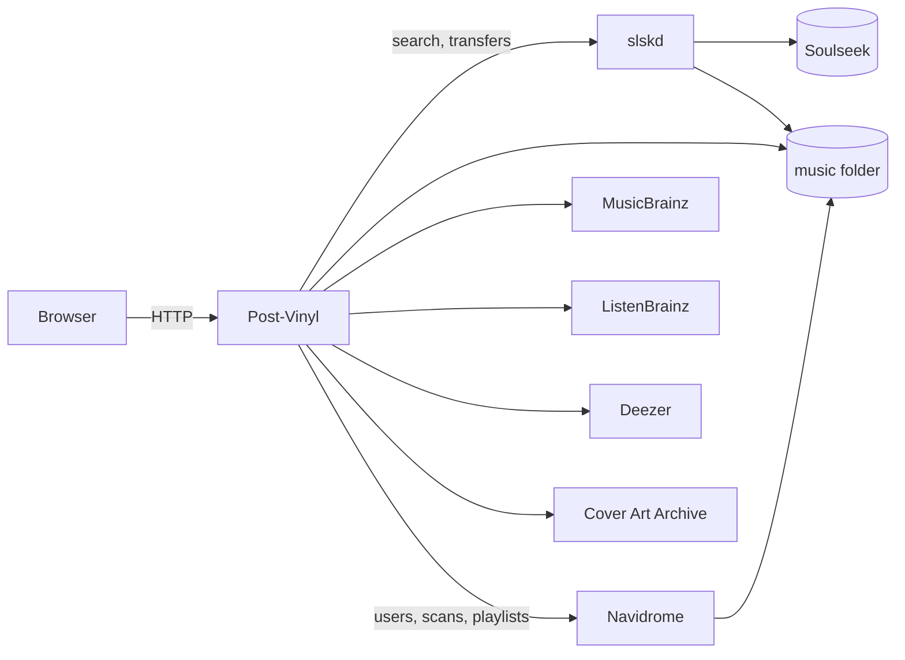

# Architecture

One Python process with an embedded SQLite database and a static frontend. It owns its own
bookkeeping and leaves everything else to the systems that already own it.



## Principles

**Never duplicate what another system owns.**

| Owner | Owns |
|---|---|
| slskd | Search results, transfers |
| Navidrome | Accounts, the library, file paths, playlist contents |
| ListenBrainz | Recommendations |
| Post-Vinyl | Songs asked for, requests, attempts, file states, peer records, pull definitions |

So no endpoint returns one of our file paths, search results are never stored, and progress is read
live.

**Re-read, don't re-search.** slskd keeps searches indefinitely, so a retry re-reads the same search
by id and re-picks from its peers. A user's re-request is a fresh ask and searches again.

**Threads and synchronous code.** Daemon-thread workers and `requests`. Clients sit behind abstract
classes, so a move to asyncio would touch only clients and workers.

**Fail waiting, not failing.** An outage on our side never marks a song not found or blames a peer.
Work waits until the service is back.

## Layers

```
routes/    HTTP only: parse, call a service, shape the response
workers/   timed loops
services/  use cases: combine clients, stores and core
core/      pure logic, no I/O, imports nothing from the app
stores/    the only code with SQL      
clients/   the only code calling outside systems
```

- A layer imports only from below. Routes and workers never touch a client or store directly.
- `core/` is stdlib-only, and the benchmark scripts import it too, so app and benchmark can't drift.
- Every client has an abstract base and a fake. So do services that routes and workers call.
- Stores are plain classes and take the connection as a parameter, so a service can combine several
  in one transaction. Tests use a real SQLite file.
- Services get their dependencies in the constructor. `build_core` in `app/main.py` builds the
  graph once.
- Every call to an outside service happens only while that source is on for the user the work is
  for; otherwise `SourceOff` (409) and nothing is sent. Tagging uses the requester's sources, a
  rename the admin's, slskd work the download's owner.

## Modules

| Module | Job |
|---|---|
| `clients/slskd.py` | Searches, transfers, server state |
| `clients/navidrome.py` | Login, users, scans, song lookup, playlists |
| `clients/musicbrainz.py`, `deezer.py` | `CatalogSource` implementations, with rate limits |
| `clients/listenbrainz.py` | Metadata, name lookup, token check, recommendations, radio, artist data |
| `clients/coverart.py`, `reach.py` | Cover Art Archive, reachability checks |
| `core/normalize.py`, `strategy.py` | Query names, query shapes |
| `core/matcher.py`, `ranking.py` | Is this file the song, peer order |
| `core/states.py`, `stall.py` | Legal state moves, attempt outcomes |
| `core/catalog_order.py`, `release_choice.py` | Result order, which release to tag as |
| `core/file_song.py`, `pulls.py` | Names from a peer's path, pull rules |
| `services/catalog.py`, `requests.py`, `sources.py` | Find and store songs, requests, per-user sources |
| `services/dispatch.py`, `download_source.py` | Hand a request to a download source |
| `services/slskd_gate.py`, `slskd_search.py`, `slskd_source.py`, `slskd_download.py`, `slskd_cleanup.py` | The slskd backend |
| `services/slskd_tab.py` | The manual slskd tab |
| `services/files.py`, `tagging.py`, `pipeline.py` | The file lifecycle |
| `services/downloads.py`, `queue_pause.py`, `library.py` | Downloads view, pause, Files tab |
| `services/pulls.py`, `playlists.py` | Pulls; the only writer of Navidrome playlists |
| `services/auth.py`, `admin.py`, `credentials.py`, `encryption.py` | Accounts and secrets |
| `services/settings.py`, `status.py` | Settings, service lights |
| `workers/` | `core_loop.py`, `download_monitor.py`, `periodic.py` |

## Swappable sources

Core asks a generic source and tracks the job from outside.

- **`DownloadSource`**: `start(request, song)` and `cancel(request_id)`. `start` returns at once, the
  source claims the request with a guarded state write (so a second dispatch does nothing), owns the
  track state from then on, and writes the `downloads` rows. Core knows nothing about how files are
  found.
- **`CatalogSource`**: search and lookup. A typed search asks the user's sources in order and shows
  the first that answers with results. `resolve` stores only the pick; linking other sources and
  choosing a release is tagging's job.

Everything Soulseek-specific stays in the slskd backend, in `slskd_*` tables and services. It never
calls a catalog.

See [adding a source](contributing.md#adding-a-source).

## Ownership

Each state value has one owner, and every move goes through `core/states.py`, so an illegal jump
raises instead of being written. Writes are conditional on the state not having changed since it
was read.

| Thing | Changed only by |
|---|---|
| `track_state`: `requested`, `dropped`, `reRequested` | requests service |
| `track_state`: `searching`, `found`, `notFound` | slskd search |
| `track_state`: `midDownload`, `downloaded`, `notDownloaded`, `badDownload` | slskd download |
| `file_state` | files service; `tagged` by tagging |
| `tagging` rows | tagging service |
| `slskd_peers` | slskd download |
| `songs`, `song_identity` | catalog service |
| `users`, `sessions` | auth and admin services |
| Navidrome playlists | playlists service |

## Startup

1. `create_app_from_env` reads the environment and YAML, refusing bad values.
2. It loads the secret key, or creates `secret.key`.
3. It runs database migrations.
4. `build_core` builds clients and services.
5. On app start, `CoreLoopWorkers.start` releases requests left `searching`, re-dispatches them,
   starts everything waiting, and starts the workers.

## Workers

Each worker has its own thread, and an error is logged without stopping the loop.

| Worker | Every | Does |
|---|---|---|
| `download-monitor` | 2 s | Follows transfers, moves to the next peer |
| `file-pipeline` | 10 s | Verify, tag, move, one scan, link |
| `cleanup` | 60 s | Forgets finished transfers at slskd, removes leftovers |
| `unverifiable` | 60 s | Deletes old downloads that failed verification. Separate so slskd being down doesn't hold it up |
| `missing-check` | 60 min | Marks vanished files `missing` |
| `redispatch` | 60 s | Starts waiting requests |
| `pull-feeder` | 5 s | Starts the next pull song |
| `pull-playlists` | 5 s | Rewrites pull playlists. Separate so Navidrome being down doesn't hold up the queue |

Besides these, the `slskd-search` thread works one in-memory FIFO queue of requests, and each typed
slskd search runs on its own short thread.

## Kept in memory

Reset by a restart: the failed-login count, the search rate window and throttle pause, the search
crash count, and the stall samples. Everything else is in the database, including the queue pause.
