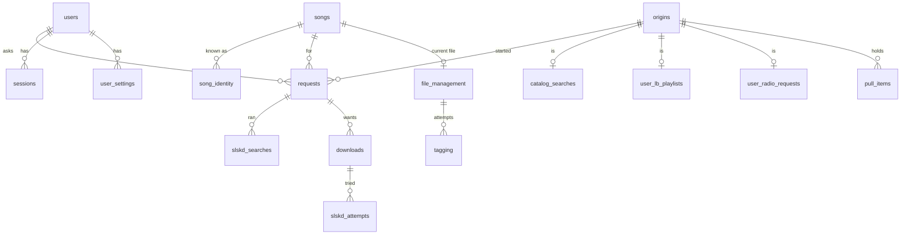

# Data model

One SQLite file. The schema is `app/stores/migrations/`; this page explains it.

## Conventions

- Times are unix seconds, passed into stores as `now`.
- Every foreign key column is indexed, and a test checks it.
- Foreign keys are on, in WAL mode, with one connection per thread.
- Stores return frozen dataclasses. Read-then-write uses `Database.transaction(write=True)`.
- Lists are page-numbered with `LIMIT/OFFSET`. A row bumped mid-browse can shift pages, which is
  accepted.
- SQLite 3.38 or newer is required (`unixepoch()`, upsert in a trigger).

## Users

| Table | Holds |
|---|---|
| `users` | Username (Navidrome's spelling), `nd_id`, encrypted password and ListenBrainz token, `lb_username`, `is_admin`, `status`, `deleted_at` |
| `sessions` | SHA-256 of the token and timestamps. Cascades with the user |
| `user_settings` | Loose JSON preferences per key. Anything needing encryption or constraints gets a column on `users` |

## Songs

| Table | Holds |
|---|---|
| `songs` | Names, credit, `query_title`, `main_artist`, album, numbers, length. Shared by all users |
| `song_identity` | `(source, source_id)` pairs: `musicbrainz`, `deezer`, `isrc`. An ISRC is a hint, not unique per song |

`find_or_create` raises `IdentityConflict` when ids point at two songs. A file picked in the slskd
tab gets a song with no identity rows. A song with a file can't be deleted.

## Requests

`requests` is the hub: one row per track asked for, whatever started it, **never pruned**.

- `source`: `catalog`, `slskd`, `lb_recs`, `lb_radio`.
- `origin_id`: optional, where it came from. Typed Soulseek searches and browsing have none.
- A typed Soulseek search is one row per user and query (a partial unique index), bumped by
  `last_used_at`, and has no song. Each picked file is its own new request with a song.
- `user_id` has no cascade, so deleting a user keeps their history.

**Origins.** `origins(id, kind)` plus a detail table per kind reusing that id: `catalog_searches`,
`user_lb_playlists`, `user_radio_requests`. Real foreign keys, no triggers or polymorphic columns.
Deletes go through `origins`. A new kind needs a detail table only if it has columns to store.

## Downloads

| Table | Holds |
|---|---|
| `downloads` | Generic: one row per file wanted, kept through every retry. `source`, `state`, `file_location` once complete |
| `slskd_searches` | One row per real slskd search, with its id (re-readable later), query and `strategy` |
| `slskd_attempts` | Each peer and file tried: `rank`, `transfer_id`, `outcome`, times |
| `slskd_peers` | Only peers with a current bad record. No row means clean. Blocked means `blocked_at` is set |

The split matters: core and the hand-off see only `downloads`, while each backend keeps its own
prefixed tables.

Download `state`: `queued`, `downloading`, `completed`, `failed`, `cancelled`. `downloads.complete()`
is the only way to `completed`.

Our ids are ours and never change. An slskd transfer id is only a column on the attempt. Transfers
the app didn't start are ignored.

Not stored, because slskd has them: search results, response counts, progress and speed.

## Files

| Table | Holds |
|---|---|
| `file_management` | One current file per song: `file_location` (relative to the source's download folder until moved), `file_state`, `verification`, `navidrome_id` |
| `tagging` | One row per attempt: `tagged` or `failTag`, error, MusicBrainz ids, tags written |

The row is created by the `downloads_completed_handoff` trigger, not by app code, and outlives the
download. No final path is stored. The library file is reached through `navidrome_id`.

States are on [the pipeline page](pipeline.md).

## Pulls

| Table | Holds |
|---|---|
| `lb_playlists` | Every song of each ListenBrainz generation, per user |
| `user_lb_playlists`, `user_radio_requests` | One pull each: name, `state`, `navidrome_playlist_id`, its range or artist and level |
| `pull_items` | Chosen songs in order: item `state`, `request_id`, `song_id`, `library_id` (a library song found by name), `in_playlist` |

Pull `state`: `running`, `done`, `cancelled`. Item `state`: `queued`, `requested`, `reused`,
`failed`, `cancelled`.

## Other

`setup_state` is a key-value table holding, among others, `queue_paused`.

## Migrations

`migrations/NNN_name.sql`, numbered without gaps. The applied number is in `PRAGMA user_version`.
Each runs in one transaction with its version bump. An app older than the database refuses to start.

**Never edit a migration that has shipped**: every change is a new file. See
[contributing](contributing.md#database-changes).
