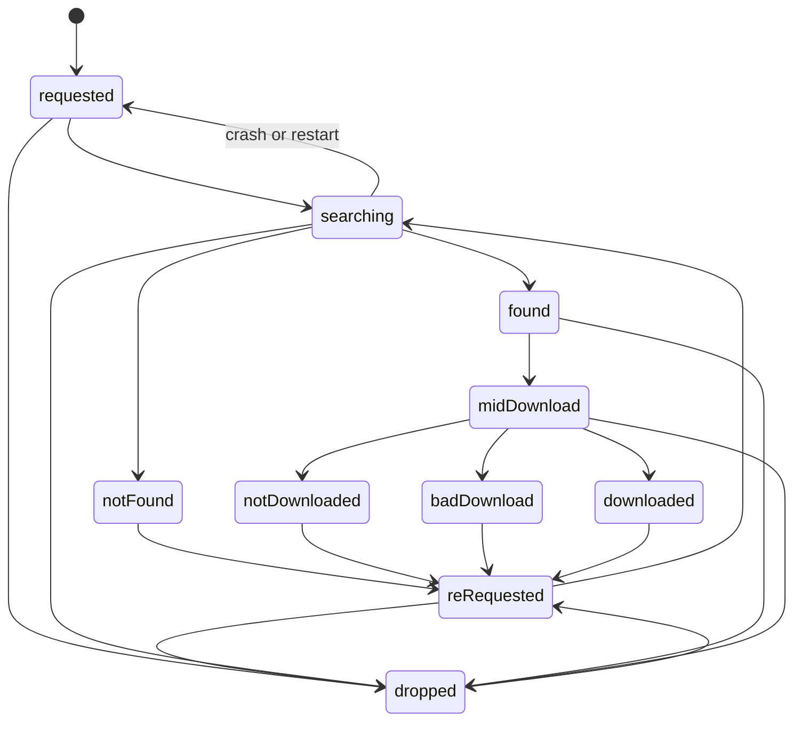
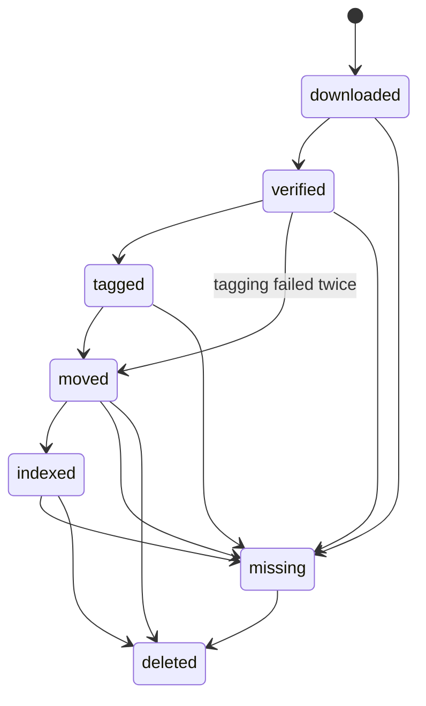

# Download pipeline

One song from request to library. A request's life is `track_state`; once a file exists, the file's
life is `file_state`.

## Ways in

| Source | `requests.source` | Starts |
|---|---|---|
| Search tab or cart | `catalog` | At once |
| slskd tab pick | `slskd` | At `found`, with one pinned file |
| Recommendations pull | `lb_recs` | When the [pull feeder](listenbrainz-pulls.md#the-queue) lets it |
| Radio pull | `lb_radio` | Same |

Every create is a new row, even for a song the user already asked for. Only the browser's cart
checks the library first. The API does no duplicate check.

## 1. Resolve

`catalog.resolve` returns a song: an existing one with that identity, or a new `songs` row and its
`song_identity`. At that point `core/normalize` computes `query_title` and `main_artist` from the
catalog's credit parts, because the joined credit can't be split back reliably.

## 2. Dispatch

`dispatch` needs a request in `requested` or `reRequested` with a song.

| Situation | Result |
|---|---|
| Queue paused | Waits. Nothing written |
| No download source on for the user | Waits. Nothing written |
| Otherwise | The user's first source claims it: `searching` |

The `redispatch` worker retries waiting requests every minute. A request nobody dispatched is
therefore never lost.

## 3. Search

The source queues the request for its single search thread. See
[search and matching](search-and-matching.md) for how queries and peers work.

| Outcome | State |
|---|---|
| At least one helpful peer | `found` |
| None, and the empty result is trusted | `notFound` |
| None, and the throttle check failed | All searching pauses 10 min, then the ladder runs again |
| slskd not ready, or lost readiness mid-search | Waits with no limit, then the same query runs again |
| Code crash, first time | Back to `requested`, re-queued |
| Code crash, second time | `notFound` |
| Dropped | Noticed before the next query; a running search is cancelled |

## 4. Download

The `downloads` row is written first, then the state moves to `midDownload`, then the file is queued
at slskd. One row covers the whole retry chain; each try is an `slskd_attempts` row.

Candidates aren't stored: they're re-read from slskd by search id, minus peers already tried and
banned. Each attempt saves into its own folder, `post-vinyl/<download>/<attempt>`, passed as slskd's
batch destination.

The monitor follows each attempt every 2 s:

| Outcome | When | Blames the peer | Uses a candidate |
|---|---|---|---|
| `completed` | slskd reports success | clears their record | |
| `noStart` | Queued past `queue_wait_seconds`, or no byte 20 s after it began downloading | yes | yes |
| `tooSlow` | Under 40 kbit/s over the last 20 s | yes | yes |
| `failed` | slskd reports failure, or refuses to queue | yes | yes |
| `skipped` | The user chose next peer, or dropped | no | yes |
| `interrupted` | slskd itself went away | no | no |

Time spent queued doesn't count toward the 20 s stall window.

**Bans.** Every failure counts. `peer_ban_failures` (3) bans a peer for `peer_ban_days` (7). Expiry
is checked on lookup. A completed download clears the peer.

**Out of candidates**, after `candidates_per_download` (5), the request ends by its last attempt:

- never started: `notDownloaded`
- started and broke, or was too slow: `badDownload`

**slskd outages.** Nothing is queued while slskd isn't logged in. A cut-off attempt ends
`interrupted`, and the same file is queued again into a new folder when slskd returns. If slskd
resumes the file by itself into its own folder, that copy is forgotten first.

**Hand-picked files** have one candidate, wait in the peer's queue without limit, and end on failure.

## 5. Hand-off

When a download reaches `completed`, a SQL trigger inserts the song's `file_management` row, or
replaces it for a re-download: state back to `downloaded`, verification cleared, `navidrome_id`
kept. That id is the only way to find the old library copy. The trigger fires only for a request
with a song, so services set the song before completion.

There is one current file per song, shared by all users.

## 6. File pipeline

Any state goes back to `downloaded` when a new copy replaces the file. `missing` means it vanished
on its own, and `deleted` means removed on purpose.

One tick: verify new downloads, tag verified files, move tagged files, then run **one** Navidrome
scan and link each moved file. See [files and tagging](files-and-tagging.md).

| Failure | Result |
|---|---|
| Verification fails | Code kept in `verification`, stays `downloaded`, no retry. Deleted after 24 h, then `missing`. The request still reads `downloaded` |
| Tagging fails | Retried once after `retag_after_seconds`, then moved untagged. Never blocks the file |
| Navidrome doesn't list the file yet | Stays `moved`, linked on a later tick |
| File vanishes | `missing` at the next check |

## 7. Cleanup

The transfer is forgotten at slskd, and failed attempts' folders and empty folders are removed. The
request, song and file rows stay. Requests are never pruned.

## Interventions

| Action | Effect |
|---|---|
| **Drop** | State moves to `dropped`. The search sees it before its next query. The monitor cancels the transfer, marks the attempt `skipped` and the download `cancelled`. The peer isn't blamed |
| **Next peer** | Cancels the transfer, `skipped`, queues the next candidate. `409` if nothing runs |
| **Re-request** | From any ended state: `reRequested`, then a fresh search |
| **Pause** | No new searches, downloads or picks. A running ladder waits before its next query. Running downloads, and moves to their next candidate, carry on. Survives restarts |

## After a restart

| State at the time | What happens |
|---|---|
| `searching` | Released to `requested` and searched again |
| `requested`, `reRequested` | Started by `redispatch_waiting` |
| `midDownload` | Attempts are in the database, and the monitor picks them up. The queue-wait clock restarts |
| Any `file_state` | Continues on the next tick |
| Running pull | Continues; its state is in the database |

## With several users

There is one search thread and one gate for the whole install, so searches are strictly serial
across users. Requests, searches and downloads are private: someone else's answers `404`. Files are
shared. Sources, tagging lookups and tokens follow the requester.
