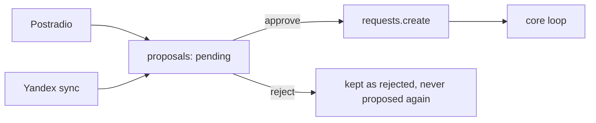

# Roadmap

**None of this is built.** These are designs and may change. Finished milestones 1–9 covered
research, clients, data, core loop, wiring, frontend and ListenBrainz pulls.

Both new sources only decide how a request **starts**. The core loop doesn't know they exist.

A source module may call only `catalog`, `proposals` and its own client and store, never slskd,
downloads or files directly.

## Milestone 10: approval inbox and Postradio

**Inbox.** A `proposals` table: user, song, origin, `action` (`add` or `delete`), `status` (pending,
approved, rejected). Approving an `add` calls `requests.create`, like a manual download. Approval is
per song with "approve all", on one page filterable by source.

**Postradio.** Its own client. A `recs` service reads the user's taste from the library, asks
Postradio, resolves each track and writes proposals, on a schedule through a `rec_puller` worker.

## Milestone 11: Yandex playlists

Any public playlist can be followed, several per user, with a token stored encrypted per user.

- Tables: `synced_playlists` (kept by id, with a PV name the user can rename, pushed to Navidrome) and
  `playlist_items`, Post-Vinyl's copy and the source of truth.
- Daily sync plus "sync now". Skip if the Yandex `revision` is unchanged, diff by Yandex track id, and
  append new tracks with an `add` proposal. Tracks seen before are never proposed again.
- **Removed in Yandex**: removed from the items, and a `delete` proposal offers deleting the file. An
  approved delete removes it from disk, with the row kept as `deleted`. It isn't offered while another
  playlist or user's request uses the song.
- The playable playlist is a view: a Navidrome playlist of items with an `indexed` file, in Yandex
  order, rewritten after each sync and as files arrive.

`ListenBrainz` is the planned name-to-MBID fallback for these title-and-artist sources.

## Milestone 12: custom playlists

`synced_playlists` becomes `playlists` with a `kind`: `synced`, `smart` (a rule stored as JSON) or
`manual`. Each answers "which songs, in what order?":

- `core/playlist_rules.py`: pure, rule and rows in, ordered song ids out.
- `services/playlists` stays the only writer to Navidrome.

Rule inputs are Post-Vinyl's stores, plus Navidrome-only fields (plays, rating, loved) fetched as
data. Rebuilds run after a sync, when a file is indexed, when inputs change, and daily for time-based
rules. Post-Vinyl owns a Navidrome playlist only if it has a row; others are never touched.

Open: whether Navidrome-only rules output `.nsp` smart playlists or fixed lists; what to do when an
owned playlist is edited in Navidrome; the rule format.

## Later ideas

- Importing listening data per source, with re-pulls, and recurring recommendation pulls
- Uploading your own files
- Notifications for failed downloads and outages
- Falling back to another download source after `notFound`; a request must then stay out of
  `notFound` until every source has failed
- Whole-album searches with folder matching, instead of one search per track
- A Latin-spelling query for Cyrillic and Korean artists, the lead on the unfound 20%
- Re-matching a hand-picked song to the catalog later
- MusicBrainz paging past 100 hits
- A periodic check for users removed in Navidrome
- Two-factor login
